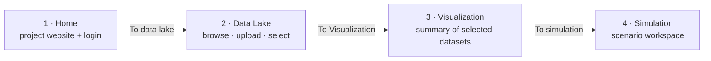

[Live app](https://vk-simulator.ttmpeiris.workers.dev)

---


https://github.com/user-attachments/assets/af52f054-293f-4b8f-884f-b23f4625b2de


# FoodChainIQ — Östergötland Food Supply Chain Resilience Platform

**FoodChainIQ** (formerly *InGenious-2026-VK*) is a data lake, visualization
and simulation platform for planning the resilience of Östergötland's food
supply chain, from everyday regional planning to total-defence and wartime
continuity planning. It is being developed in the InGenious 2026 programme
(Linköping University) with Vreta Kluster.

## The four windows



| # | Window | What you do there | Status |
|---|---|---|---|
| 1 | **Home** | Read about the project and sign in. Once you are signed in, a **To data lake** button appears. | planned |
| 2 | **Data Lake** | A home page in the style of Google Drive. Browse the datasets you can access, select one or more, upload new ones (several data files plus one standard metadata file, kept **private**, shared with a **group**, or **public**), and request removal of your own datasets. | planned |
| 3 | **Visualization** | A visual summary of the selected datasets: coverage map, field profiles, charts and a simulation-readiness check. | planned |
| 4 | **Simulation** | The scenario workspace, run on the selected datasets. | **live** (on the synthetic baseline); dataset input planned |

## Structure

- `documentation/` — concept, specifications and API
  - `ostergotland-food-resilience-platform-concept.md` — concept & architecture (data layers, stakeholders, governance, roadmap)
  - `foodchainiq-application-windows.md` — functional spec of the four windows and the user flow
  - `api/README.md` — API reference (auth, data lake, selections, visualization, simulation)
  - `api/openapi.yaml` — OpenAPI 3.1 spec for the same API
  - `api/dataset-metadata.schema.json` — JSON Schema for the standard dataset metadata file ([example](documentation/api/examples/metadata.example.json))
- `Implementation/` — the web application (React + Vite + MapLibre GL). Today it contains the Simulation window.
- `backend/` — the Python service (FastAPI + networkx). Today it contains the
  simulation engine, which models supply-chain disruptions and their effect on
  people. The data lake, auth and visualization endpoints are specified in
  `documentation/api/` and are not built yet.

## Start here

Read `documentation/ostergotland-food-resilience-platform-concept.md` for the
concept, then `documentation/foodchainiq-application-windows.md` for how the
application works, and `documentation/api/README.md` for the API.

### Run the platform

**Windows, quick start:** double-click **`run.bat`** in the repo root. It
creates the Python venv and installs dependencies on first run, then starts both
servers (each in its own window) and opens the app.

**Manual (any OS) — two parts.** The map viewer talks to the simulation backend
over `/api` (Vite proxies it). Start the backend first:

```
cd backend
python -m venv .venv && .venv\Scripts\activate      # source .venv/bin/activate on macOS/Linux
pip install -r requirements.txt
uvicorn app.main:app --reload --port 8000
```

Then, in another terminal, the frontend:

```
cd Implementation
npm install
npm run dev
```

The viewer still runs without the backend — you just lose the scenario
simulator. See `backend/README.md` for the model and API.
