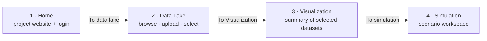

[Live app](https://vk-simulator.ttmpeiris.workers.dev)

---


https://github.com/user-attachments/assets/af52f054-293f-4b8f-884f-b23f4625b2de


# FoodChainIQ — Östergötland Food Supply Chain Resilience Platform

**FoodChainIQ** (formerly *InGenious-2026-VK*) is a data lake, visualization
and simulation platform for planning the resilience of Östergötland's food
supply chain, from everyday regional planning to total-defence and wartime
continuity planning. It is being developed in the InGenious 2026 programme
(Linköping University) with Vreta Kluster.

## The four windows



| # | Window | Route | What you do there |
|---|---|---|---|
| 1 | **Home** | `/` | Read about the project and sign in. Once you are signed in, a **To data lake** button appears. |
| 2 | **Data Lake** | `/datalake` | A dataset browser in the style of Google Drive. Search and filter the datasets you can access and select one or more. Upload new ones (several data files plus one standard `metadata.json`) and keep each **private**, share it with a **group**, or make it **public**. Request removal of your own datasets; admins approve or reject requests. |
| 3 | **Visualization** | `/visualize?selection=…` | A visual summary of the selection: KPIs, a coverage map, automatic charts, field profiles, cross-dataset checks and simulation readiness. |
| 4 | **Simulation** | `/simulate?selection=…` | The scenario workspace, running on the baseline network merged with the selected datasets. Each selected dataset is also a map layer. |

All four windows are implemented: `frontend/` (React) talks to `backend/`
(FastAPI + PostgreSQL). Uploaded files are stored on disk in
`backend/storage/`.

## Structure

- `frontend/` — the web app (React 18 + Vite + React Router + MapLibre GL). See `frontend/README.md`.
- `backend/` — the API (FastAPI, SQLAlchemy + PostgreSQL, networkx simulation engine). See `backend/README.md`.
- `documentation/` — concept, specifications and API
  - `ostergotland-food-resilience-platform-concept.md` — concept & architecture
  - `foodchainiq-application-windows.md` — functional spec of the four windows
  - `api/README.md` — API reference · `api/openapi.yaml` — OpenAPI 3.1 spec
  - `api/dataset-metadata.schema.json` — the standard dataset metadata file ([example](documentation/api/examples/metadata.example.json))
- `docker-compose.yml` — local PostgreSQL
- `run.bat` / `run.sh` — one-command dev launchers

## Run the platform

You need **Python 3.11+**, **Node 22** and **PostgreSQL 14+**. Docker is the
easiest way to get PostgreSQL.

**Quick start: one command starts everything.**

On Windows, double-click **`run.bat`**. On macOS or Linux, run:

```bash
./run.sh
```

Either launcher:

1. checks that Python 3.10+, Node.js and npm are installed, and that ports
   8000 and 5173 are free;
2. starts PostgreSQL with `docker compose up -d db`, if Docker is running.
   Otherwise it uses the database in `backend/.env`;
3. creates the Python venv and installs backend and frontend dependencies on
   first run, and again whenever `requirements.txt` or `package-lock.json`
   changes;
4. waits for the database, starts the backend and waits until
   `/api/health` answers;
5. starts the frontend and opens http://localhost:5173 in your browser.

To stop the app, press Ctrl+C in the terminal (`run.sh`) or close the two
server windows (`run.bat`). The database container keeps running; stop it with
`docker compose stop db`. Set `NO_BROWSER=1` to skip opening the browser, or
`NO_DOCKER=1` (`run.sh` only) to leave Docker alone.

**Manual.** Start in this order:

1. Start the database:

   ```bash
   docker compose up -d db
   ```

   You can use your own PostgreSQL instead. Copy `backend/.env.example` to
   `backend/.env` and set `DATABASE_URL`.

2. Start the backend. Run each of these commands from the repo root.

   ```bash
   cd backend
   ```

   ```bash
   python -m venv .venv
   ```

   Activate the venv. On macOS or Linux:

   ```bash
   source .venv/bin/activate
   ```

   On Windows, run `.venv\Scripts\activate` instead.

   ```bash
   pip install -r requirements.txt
   ```

   ```bash
   uvicorn app.main:app --reload --port 8000
   ```

   On first start the backend creates the tables and seeds an admin. It also
   seeds demo users, groups and five synthetic datasets, unless you set
   `SEED_DEMO=false`.

3. Start the frontend in another terminal:

   ```bash
   cd frontend
   ```

   ```bash
   npm install
   ```

   ```bash
   npm run dev
   ```

4. Open http://localhost:5173 and sign in.

### Demo accounts (seeded when `SEED_DEMO=true`)

| Email | Password | Role |
|---|---|---|
| `admin@foodchainiq.local` | `admin1234` | Platform admin (approves removal requests). Set `ADMIN_EMAIL` / `ADMIN_PASSWORD` to change it. |
| `planner@foodchainiq.local` | `planner1234` | User, admin of the *Länsstyrelsen Östergötland* group, member of *Vreta Kluster producers* |
| `producer@foodchainiq.local` | `producer1234` | User, admin of the *Vreta Kluster producers* group |

Change these before exposing the app anywhere.

### Tests

Run the backend tests against a throwaway database (default
`foodchainiq_test`; override it with `TEST_DATABASE_URL`). First create the
test database:

```bash
createdb -h localhost -U foodchainiq foodchainiq_test
```

Then run the tests from `backend/`:

```bash
pytest -q
```

### Static deployment

The Cloudflare deploy (`frontend/wrangler.jsonc`) serves only the static
frontend. Sign-in and every window after Home need the backend, so host
`backend/` and its PostgreSQL somewhere, then build the frontend with
`VITE_API_BASE` (see `frontend/README.md`). **If Cloudflare auto-deploys from
Git, change the build's root directory from `Implementation` to `frontend`.**
