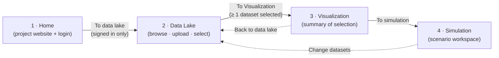

# FoodChainIQ — Application Windows & User Flow
### Functional Specification

Companion to `ostergotland-food-resilience-platform-concept.md` (concept &
architecture) and `api/README.md` (API reference).

> **Status.** Window 4 (Simulation) exists today as the GIS workspace in
> `Implementation/`. Windows 1–3 (Home, Data Lake, Visualization), the login
> and the dataset-aware simulation are **specified here and not yet built**.
> Everything below is the target behaviour.

---

## 1. Overview

FoodChainIQ is organised as four main windows. You move through them in order,
and each window passes its context (who you are, which datasets you picked) on
to the next:



| # | Window | Route | Who can open it | Main job |
|---|---|---|---|---|
| 1 | Home | `/` | Everyone | Present the project; sign in |
| 2 | Data Lake | `/datalake` | Signed-in users | Browse, upload, select, request removal of datasets |
| 3 | Visualization | `/visualize?selection={id}` | Signed-in users | Summarise the selected datasets visually |
| 4 | Simulation | `/simulate?selection={id}` | Signed-in users | Run disruption scenarios using the selected datasets |

### The dataset selection

The thread through windows 2 → 3 → 4 is a **selection**: an ordered list of
dataset IDs. When the user clicks **To Visualization**, the frontend saves
the selection on the server (`POST /api/selections`) and gets back a
`selection_id`. That ID goes in the URL of windows 3 and 4. This means that:

- a page refresh or a shared link reopens the same set of datasets;
- the visualization and the simulation always use exactly the same data;
- the server checks access again whenever a selection is opened. If you lose
  access to a dataset, it is dropped from your view with a notice.

---

## 2. Window 1 — Home (project website)

The public face of FoodChainIQ. It works like the project's own website.

**Content (no sign-in needed)**
- Hero: product name **FoodChainIQ**, a one-line pitch, and a short
  explanation of the Östergötland food-system resilience mission.
- About / How it works: the four steps (Data Lake → Visualization →
  Simulation), the partners (Vreta Kluster, InGenious 2026 / Linköping
  University) and the data layers (see concept doc §5).
- Demo video and screenshots.
- Public catalogue teaser (optional): the number of public datasets and the
  categories covered (`GET /api/stats/public`). No dataset content is shown.
- Contact / request access.

**Login**
- A **Sign in** button in the top bar opens a login form (email + password).
- If sign-in succeeds (`POST /api/auth/login`), the top bar shows the user's
  name and a menu (profile, sign out).
- Once signed in, a primary **To data lake** button appears in the hero
  and the top bar. Signed-out visitors never see it.
- If sign-in fails, the form shows the error inline. After repeated failures
  the account is rate-limited (see API doc §2).
- Session: a short-lived access token plus a refresh token in an httpOnly
  cookie. The user stays signed in across windows until they sign out or the
  refresh token expires.

**Acceptance criteria**
- [ ] A signed-out visitor sees no **To data lake** button. Opening
      `/datalake` directly sends them to `/` with the login form open.
- [ ] After sign-in the button appears without a full page reload.
- [ ] Signing out from any window returns the user to `/` and revokes the
      refresh token.

---

## 3. Window 2 — Data Lake

A file-browser home page in the style of Google Drive, where the files are
**datasets**.

### 3.1 Layout

```
┌──────────────────────────────────────────────────────────────────────────┐
│ FoodChainIQ    [ Search datasets...                 ]        (user v)    │
├───────────────┬──────────────────────────────────────────────────────────┤
│ + New dataset │  Category v  Format v  Owner v  Updated v   [grid|list]  │
│               │                                                          │
│ > All         │  [ ] Farms 2025     [x] Dairy capacity  [ ] Roads E4     │
│ > My datasets │      production         processing          logistics    │
│ > Shared with │      PRIVATE            GROUP               PUBLIC       │
│   my groups   │                                                          │
│ > Public      │  [x] Population SCB [ ] Substations                      │
│ > Removal     │      population         energy                           │
│   requests    │      PUBLIC             GROUP  (removal pending)         │
│               │                                                          │
│ Storage used  ├──────────────────────────────────────────────────────────┤
│ 1.2 / 10 GB   │ 2 selected · Clear                  [ To Visualization ] │
└───────────────┴──────────────────────────────────────────────────────────┘
```

- **Left sidebar.** A **+ New dataset** button and the views:
  - *All*: everything the user can see.
  - *My datasets*: datasets the user owns, whatever their visibility.
  - *Shared with my groups*: group datasets from the user's groups.
  - *Public*: public datasets from all users.
  - *Removal requests*: status of the user's own removal requests.
  - A storage quota meter.
- **Top bar.** Full-text search over title, description and keywords.
- **Filter chips.** Category (platform data layer), file format, owner,
  last updated, visibility.
- **Grid / list toggle.** Cards show an icon by category, the title, the
  owner, the updated date, the visibility badge (🔒 private · 👥 group ·
  🌐 public) and the status (`processing`, `ready`, `invalid`,
  `removal pending`).
- **Details pane.** Clicking a card (not its checkbox) opens a right-side
  pane with the metadata, the file list with sizes, the licence, the source
  and a small preview (`GET /api/datasets/{id}`, `…/preview`).

### 3.2 Selecting datasets

- Each card has a checkbox. Users can select one or more datasets, and
  shift-click selects a range.
- The selection is kept while the user switches sidebar views or changes
  filters. The bottom action bar shows the count and a **Clear** link.
- The **To Visualization** button is enabled when at least one dataset with
  status `ready` is selected. Datasets that are `processing` or `invalid`
  cannot be selected.
- Clicking it calls `POST /api/selections` and opens
  `/visualize?selection={id}`.

### 3.3 Adding a dataset

**+ New dataset** opens a three-step upload dialog:

1. **Files.** Drag and drop or browse **one or more data files**, plus
   **exactly one standard metadata file** (`metadata.json`; see
   `api/README.md` §6 and `api/dataset-metadata.schema.json`).
   A *Download metadata template* link fetches `GET /api/metadata/template`.
   Supported data formats: CSV, XLSX, GeoJSON, GeoPackage, zipped Shapefile,
   Parquet and JSON.
2. **Validate.** The metadata file is checked on the spot
   (`POST /api/metadata/validate`). Errors are listed by field. A warning is
   shown when a file listed in the metadata was not uploaded, or the other
   way round.
3. **Sharing.** Choose a visibility:
   - **Private.** Only the user (and platform admins) can see it.
   - **Group.** The user picks one of their groups. All members of that
     group can see and select it.
   - **Public.** Every signed-in FoodChainIQ user can see and select it.

   If the metadata declares `"sensitivity": "restricted"`, the **Public**
   option is disabled, following the tiered-access rule in the concept doc §9.

On **Upload** the files go to `POST /api/datasets` (multipart). The card
appears straight away with status `processing`. When server-side ingestion
(format checks, column profiling, bounding box, summary statistics) finishes,
the status changes to `ready`, or to `invalid` with a reason.

The owner can later edit the title, description, keywords and visibility from
the details pane (`PATCH /api/datasets/{id}`).

### 3.4 Requesting removal

Users **request** removal; they do not delete datasets directly. Other users'
selections and past simulation runs may depend on a dataset, and removing it
is audited.

- The details pane of a dataset the user **owns** has a **Request removal**
  button that asks for a reason.
- `POST /api/datasets/{id}/removal-requests` creates the request. The card
  shows the badge `removal pending`. The dataset stays visible and usable
  until the request is decided.
- A platform admin approves or rejects it. If approved, the dataset is
  withdrawn from the catalogue and from every selection, and its files are
  purged after the retention period. If rejected, the badge is cleared and
  the reason is shown to the owner.
- Owners can cancel a pending request.
- Users can only request removal of their own datasets. For a dataset owned
  by someone else, the details pane shows a **Report** link instead (out of
  scope for v1).

**Acceptance criteria**
- [ ] A dataset with `private` visibility never shows up for another
      non-admin user, in any view or search.
- [ ] Changing visibility from `group` to `private` removes the dataset from
      other members' views straight away. Their existing selections then
      leave it out, with a notice.
- [ ] An upload with no metadata file, or more than one, is rejected before
      any data file is stored.
- [ ] **To Visualization** is disabled while nothing is selected.

---

## 4. Window 3 — Visualization

A dashboard that summarises **the selected datasets visually**, so the user
can check them before committing them to a simulation.

### 4.1 Content

Data comes from `GET /api/visualizations/summary?selection_id={id}`.

- **Header.** The selection's dataset chips (removable, which creates a new
  selection), a **Back to data lake** link and the primary **To simulation →**
  button.
- **Overview KPIs.** Number of datasets, total records, total features with
  geometry, combined time span, and coverage of Östergötland's 13
  municipalities.
- **Coverage map.** A MapLibre map showing each dataset's footprint (bbox or
  simplified geometry, `…/geometry?simplify=…`), coloured by dataset, over
  the county boundary.
- **Per-dataset cards.** For each dataset:
  - metadata summary (source, licence, owner, visibility, updated date);
  - field profile: each column's type, unit, % missing, and min/max/mean or
    the top categories;
  - an automatic chart chosen by data shape: a time series for temporal
    data, a bar chart of top categories, a histogram for numeric fields, or a
    point/choropleth map for spatial data;
  - its **simulation role** from metadata (`production`, `processing`,
    `logistics`, `energy`, `population`, `demand`, `reference`).
- **Cross-dataset panel.** Overlapping time ranges and overlapping spatial
  extents. Warnings, for example "two datasets both claim the `population`
  role" or "dataset X has no geometry and will be used as tabular input only".
- **Simulation readiness checklist.** Shows which simulation inputs the
  selection provides and which will fall back to the built-in baseline
  network (see §5).

### 4.2 Behaviour

- The summary is computed on the server and cached per selection, so large
  datasets are never sent to the browser whole.
- Every chart uses the shared palette and is labelled with its dataset.
  Sample or synthetic data is badged as it is in the current workspace.
- **To simulation** opens `/simulate?selection={id}` with the same ID.

**Acceptance criteria**
- [ ] Opening a selection the user can no longer fully access shows the
      datasets that are still accessible, plus a notice listing what was
      removed.
- [ ] The readiness checklist matches what `GET /api/simulation/context`
      reports for the same selection.

---

## 5. Window 4 — Simulation

The **existing GIS scenario workspace** (`Implementation/`: Layers ·
Simulation + Map · Results · Timeline), extended to run on the selected
datasets.

### 5.1 What changes

- The app bar shows a **Datasets** chip listing the active selection, with a
  **Change datasets** link back to the Data Lake.
- On load, the workspace calls `GET /api/simulation/context?selection_id={id}`.
  This returns the baseline network merged with the selected datasets, matched
  by their metadata `simulation.role`:

  | Dataset role | Effect on the simulation network |
  |---|---|
  | `production` | Adds or replaces farm / supply nodes (`production_tpd`) |
  | `processing` | Adds or replaces processing & storage nodes (`capacity_tpd`, `stock_tonnes`) |
  | `logistics` | Adds or replaces corridors (`capacity_tpd`, `distance_km`, `mode`) |
  | `energy` | Adds substations and `depends_on` links |
  | `population` / `demand` | Replaces town populations / demand (`demand_tpd`, `local_stock_days`) |
  | `reference` | Display only: shown as a map layer and not fed to the solver |

  Any inputs the selection does not provide fall back to the built-in
  synthetic baseline. The workspace shows which ones did.
- Each selected dataset with geometry is mounted as a **map layer** in the
  Layers panel, in a "Selected datasets" group.
- **Run simulation** sends the scenario with the `selection_id`
  (`POST /api/simulate`). The result records which dataset versions were
  used, so a run can be reproduced later.
- With no `selection_id` in the URL, the workspace behaves exactly as it
  does today, on the synthetic baseline only.

---

## 6. Roles & permissions

| Capability | Visitor | User | Group admin | Platform admin |
|---|:-:|:-:|:-:|:-:|
| View Home | ✓ | ✓ | ✓ | ✓ |
| Sign in / open Data Lake | — | ✓ | ✓ | ✓ |
| See public datasets | — | ✓ | ✓ | ✓ |
| See group datasets | — | own groups | own groups | ✓ |
| See private datasets | — | own | own | ✓ |
| Upload datasets | — | ✓ | ✓ | ✓ |
| Edit own dataset / visibility | — | ✓ | ✓ | ✓ |
| Request removal of own dataset | — | ✓ | ✓ | ✓ |
| Manage group members | — | — | own groups | ✓ |
| Approve / reject removal requests | — | — | — | ✓ |
| Visualize & simulate a selection | — | ✓ | ✓ | ✓ |

"Public" in FoodChainIQ means **visible to all signed-in users**. Dataset
contents are never served to anonymous visitors.

---

## 7. Non-functional requirements

- **Security.** HTTPS only; bcrypt/argon2 password hashing; JWT access tokens
  (15 min) and rotating refresh tokens (7 days); every dataset access checked
  on the server, never only in the UI; audit log for uploads, visibility
  changes, downloads and removals (concept doc §9).
- **Limits (v1 defaults).** 2 GB per upload, 50 files per dataset, a 10 GB
  quota per user (configurable), and 20 datasets per selection.
- **Storage.** Raw files go in object storage (S3-compatible). Metadata,
  ACLs and summaries go in PostgreSQL + PostGIS. Every metadata or file change
  creates a new **dataset version**, and a selection pins versions.
- **Performance.** The Data Lake list loads in under 1 s for 1,000 datasets
  (paginated). The visualization summary loads in under 3 s once cached.
